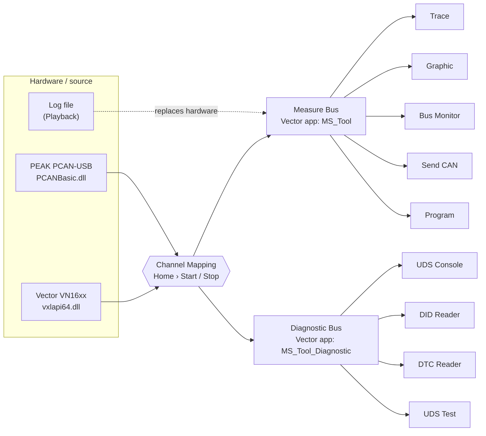

<div align="center">

# MS_Tool — CAN / CAN FD Analyzer & UDS Diagnostic Suite

**Measure, analyze, simulate and diagnose automotive CAN networks from one Windows desktop app.**

[](#-installation)
[](#-built-with)
[](#-built-with)
[](#-supported-hardware--file-formats)
[](#-uds-diagnostics)
[](#-uds-diagnostics)
[](#-licensing)

[Download](#-installation) · [Quick Start](#-quick-start) · [Documentation](#-documentation) · [Scripting](#-program-scripting-capl-style-in-python) · [Troubleshooting](#-troubleshooting)

</div>

<!-- Tip: add a screenshot of the main window here, e.g. docs/screenshot-main.png -->

---

## 📖 Overview

**MS_Tool** is a professional-grade Windows application for automotive network engineers. It brings the everyday workflows of tools such as CANoe and TSMaster into a single, lightweight package:

- **Bus measurement** — live trace, signal plotting, logging and log playback on CAN and CAN FD.
- **UDS diagnostics** (ISO 14229) over **ISO-TP** (ISO 15765-2) — manual console, batch DID reading with BOM comparison, multi-ECU DTC read/clear.
- **Test & simulation** — scripted UDS test sequences with PASS/FAIL, plus a CAPL-style event-driven runtime in Python (or drag-and-drop blocks) that exports to CAPL.
- **Offline tools** — a full DBC editor and a step-by-step CRC calculator.

It runs on **Vector VN16xx** (e.g. VN1640) and **PEAK PCAN-USB** interfaces. The driver libraries `vxlapi64.dll` and `PCANBasic.dll` ship in the `Lib` folder next to the executable, so nothing has to be copied into Windows system folders.

---

## ✨ Features

### 📡 Bus measurement & analysis

| Window | What it does |
|---|---|
| **CAN Database** | Multiple named networks (e.g. `PT`, `CHS`, `BD`), each with its own DBC. Background loading for large files, *Network › Node › TX/RX* topology, full signal attributes, search by name or ID. |
| **Trace** | One row per ID, updated in place, with DBC signal decoding. Per-ID FPS, stale IDs greyed out, column sets for CAN / CAN FD / J1939 / CANopen, filter, pause/resume, CSV export and snapshots. |
| **Graphic** | Real-time signal plotting — overlay or separate strips, two measurement cursors with ΔY, value-table signals drawn as steps, live comments on the timeline, undo/redo view, CSV/PNG export. |
| **Sequence Check** | Rule engine for vehicle operating sequences (HV ON/OFF, charging, LV top-up, driving): trigger, timed steps with min/max windows, invariants, abort conditions and timeouts — run against recorded logs. |
| **Bus Monitor** | **Log** to BLF / ASC / TXT (with a `.meta.json` channel map) and **Playback** BLF, ASC, TRC, CSV, candump `.log`, MF4 and DB without hardware. Auto channel mapping, A→B range, x0.5–x10 or fast speed, cut-to-BLF, cycle-time statistics. |
| **Send CAN** | DBC-based or raw messages, cyclic or manual, BRS for CAN FD. Signal generators (Checksum, Alive Counter, Ramp, Random) with configurable E2E CRC. Import/export queues as JSON. |

### 🩺 UDS diagnostics

| Window | What it does |
|---|---|
| **Diagnostic Setting** | Per-vehicle **Program**: ECU list imported from a diagnostic DBC (11- and 29-bit IDs), services/DIDs from templates, Security Access DLL per ECU, DTC database generated from ODX Excel, ASCII translation rules. |
| **UDS Console** | Type requests in any hex style (`22 F1 90`, `22F190`, `0x22,0xF1,0x90`). Decoded responses with full NRC names, ASCII decoding and response time, raw ISO-TP frame log (FF / CF / FC), Tester Present, automatic seed → key. |
| **DID Reader** | Batch-read Part Number, HW, SW, Boot, CAL… across many ECUs with retries and per-row status. **BOM Check** compares results against an Excel BOM. Colour-preserving Excel export. |
| **DTC Reader** | Reads all selected ECUs in parallel (`10 01 → 10 03 → 19 01 → 19 02`) with a configurable status mask; confirmed **Clear DTC** (`14 FF FF FF`); 3-sheet Excel report (Summary, DTC List, Raw). |

### 🧪 Test & automation

| Window | What it does |
|---|---|
| **UDS Test** | Build test sequences from a services tree. Expected-response wildcards (`XX`, `*`, `NRC 31`, `NO RESP`), `delay(ms)` / `cyclic(ms)` timing, automatic Security Access, PASS/FAIL with response time, results to Excel / CSV / log. |
| **Program** | CAPL-style, event-driven logic on the Measure Bus — ECU simulation, gateways, fault injection, UDS calls, E2E. Write it in **Python** or with **drag-and-drop blocks** (two-way sync), debug with live highlighting, then **export to CAPL** for CANoe. |

### 🛠 Offline tools

| Window | What it does |
|---|---|
| **DBC Editor** | Master–detail editing of messages and signals, bit-layout preview with overlap detection, value tables, attribute definitions, error list. Untouched DBC sections, encoding and line endings are preserved on save. |
| **CRC Calculator** | Preset CRC parameter sets (e.g. CRC-8 SAE-J1850), byte-range calculation, compare against a byte in the frame, and a register-level step-by-step trace that explains the algorithm. |

### 🧩 Workspace

- **Projects** save the whole session — networks, DBC paths, channel mapping, open windows and their settings. The last project reopens automatically.
- **Desktops** — tabbed workspaces at the bottom of the window, each with its own arranged set of windows (cascade / tile).
- **Light / Dark theme**, a central **System Messages** log, and a **Start / Stop** model: every window opens stopped and only runs after *Home › Start*.

---

## 🏗 Architecture

MS_Tool separates traffic into two logical buses. **Channel Mapping** assigns each network to a physical channel, and *Home › Start* opens both.



- A **Vector** channel can serve both buses at once, because MS_Tool opens two separate Vector application names.
- Any **other** interface (PEAK, Virtual…) can hold only one role — measurement *or* diagnostics.
- During **Playback**, frames from the log feed the Measure Bus; nothing is transmitted to a real bus.

---

## 🔌 Supported hardware & file formats

| Category | Supported |
|---|---|
| **Interfaces** | Vector VN16xx (e.g. VN1640), PEAK PCAN-USB · SocketCAN and Virtual are also selectable in *Hardware Configuration* |
| **Bus types** | CAN 2.0, CAN FD (configurable nominal and data bit rates, BRS) |
| **Diagnostics** | UDS ISO 14229-1, ISO-TP ISO 15765-2, 11-bit and 29-bit IDs, P2 / P2* / STmin (incl. 100–900 µs) |
| **Database** | DBC |
| **Log — record** | BLF, ASC, TXT (MS_Tool format) — BLF/ASC open in CANoe and TSMaster |
| **Log — replay** | BLF, ASC, TXT, TRC (PEAK), CSV, candump `.log`, MF4 (ASAM MDF), DB (SQLite) |
| **Reports** | Excel `.xlsx`, CSV, PNG |

---

## 📦 Installation

**Requirements:** Windows 10 / 11 (64-bit), [7-Zip](https://www.7-zip.org/), and the device driver for your CAN interface (Vector or PEAK).

1. Download all three parts of the release from this repository:
   `MS_Tool_2.7z.001`, `MS_Tool_2.7z.002`, `MS_Tool_2.7z.003` — keep them in the same folder.
2. Right-click **`MS_Tool_2.7z.001`** › *7-Zip › Extract Here*. This produces `MS_Tool.zip`.
3. Extract `MS_Tool.zip` to a folder of your choice (e.g. `C:\Tools\MS_Tool`).
4. Run **`MS_Tool\MS_Tool.exe`**.

> [!NOTE]
> The tool is a self-contained build — no Python installation is required. Keep the `Lib` folder (`vxlapi64.dll`, `PCANBasic.dll`) next to `MS_Tool.exe`.

### 🔑 Activation

MS_Tool opens its main window only with a valid license for the current machine.

1. On first launch the **Activation** screen appears. Click **Copy** next to your **Machine ID**.
2. Send the Machine ID to the provider and receive a key string or a `.lic` file.
3. Paste the key, or click **Open .lic file** — the main window opens.

**Deploying to many PCs:** place `license.lic` next to `MS_Tool.exe`; the tool activates itself on first start.

---

## 🚀 Quick start

<details open>
<summary><b>Measure a CAN bus</b></summary>

1. **File › New** (or **File › Open** an existing project).
2. **Bus › Database › Add CAN Database** — add a network (e.g. `PT`) and load its DBC.
3. **Hardware › Hardware Configuration** — tick the device type (Vector, PEAK…), choose CAN or CAN FD and the bit rate, then **Save**.
4. **Hardware › Channel Mapping** — click **Scan Devices**, pick a device for each network in the *Measure Bus* table and set **Active = Yes**.
5. Open **Bus › Trace** (and **Bus › Graphic** to plot signals).
6. **Home › Start** — frames appear immediately.
7. **Home › Stop**, then **File › Save**.

</details>

<details open>
<summary><b>Run UDS diagnostics</b></summary>

1. **Diagnostics › Diagnostic Setting** — create a Program, import ECUs from the diagnostic DBC, add services, select a Security Access DLL if needed, then **Save**.
2. **Hardware › Channel Mapping** — map the diagnostic network in the *Diagnostic Bus* table and set **Active = Yes**.
3. **Hardware › Hardware Configuration** — check P2, P2*, STmin and CAN type in the *Diagnostic* section.
4. **Home › Start**.
5. Use **UDS Console** for manual requests, **DID Reader** for ECU identification, or **DTC Reader** to read / clear faults.

</details>

> [!WARNING]
> Don't run UDS Console, DID Reader, DTC Reader and UDS Test against the **same ECU** at the same time — each window has its own engine and they will compete for responses.

---


```

| Events | Common runtime functions |
|---|---|
| `@on_start` · `@on_stop` · `@on_message(m)` · `@on_signal(m, sig)` · `@on_timer("t")` · `@on_key("a")` · `@sequence("name")` | `send()` · `send_cyclic()` · `set_signal()` · `forward()` · `set_timer()` · `wait()` · `e2e_message()` · `write()` |

Messages can be addressed by DBC name (`"C2_ESC_Info"`), with a network prefix (`"CAN2::C2_ESC_Info"`), or by raw ID (`0x271`). See the Program guides below for the full API and block reference.

---

## 🔐 Licensing

Each key is bound to the machine's **Machine ID** (derived from the mainboard, so it survives a Windows reinstall), has an **expiry date**, and unlocks a **feature level**: `Basic`, `Standard`, `Pro`, `Full`, or `Custom` (individually selected features).

- Menu items outside your license are shown dimmed with 🔒; hover to see the missing feature.
- Some in-window features are licensed separately: *Graphic › Sequence Check*, *DID Reader › BOM Check*, DID write (`0x2E`) and automatic Security Access key calculation.
- *Help › License…* shows your level, issue/expiry dates and the feature list, and accepts a new key. A reminder appears when 14 days or fewer remain.

---

## 📚 Documentation

Full user guides (in Vietnamese) are included in this repository:

| Guide | Contents |
|---|---|
| 📘 [Hướng dẫn sử dụng MS_Tool](H%C6%B0%E1%BB%9Bng%20d%E1%BA%ABn%20s%E1%BB%AD%20d%E1%BB%A5ng%20MS_Tool.pdf) | User manual — every menu and window, troubleshooting, UDS/NRC/DTC reference tables (25 pages) |
| 📗 [Hướng dẫn sử dụng Program widget](H%C6%B0%E1%BB%9Bng%20d%E1%BA%ABn%20s%E1%BB%AD%20d%E1%BB%A5ng%20Program%20widget.pdf) | Program window — layout, Python runtime API, E2E, CAN FD, CAPL export (45 pages) |
| 📙 [Hướng dẫn các block của Program](H%C6%B0%E1%BB%9Bng%20d%E1%BA%ABn%20c%C3%A1c%20block%20c%E1%BB%A7a%20Program.pdf) | Block reference — events, CAN, timers, control, UDS blocks with worked examples (16 pages) |

<details>
<summary><b>Data folder layout</b></summary>

Diagnostic data and the Sequence Check library live in the MS_Tool folder and are shared by every project. The Program folder name is the Program name shown in all diagnostic windows.

```text
<MS_Tool folder>/
├─ Lib/                                  vxlapi64.dll, PCANBasic.dll
├─ Projects/                             saved projects (File › Open)
├─ Diagnostics Setting/
│  └─ <Program>/
│     ├─ <Program>_DID_Config.json       ECUs, Req/Resp IDs, services, DLL
│     ├─ <Program>_ASCIIRule.json        ASCII translation rules
│     └─ <Program>_DTC/
│        └─ <ECU>_DTC.json               DTC codes, names, repair actions
├─ Sequence Check/<name>.json            Graphic › Configurations sequences
├─ Template_DID_BOM_Compare.xlsx         BOM template for DID Reader › BOM Check
└─ license.lic                           (optional) auto-activation

%APPDATA%\MS_Tool\logs\startup.log       startup step timings
```

</details>

---

## 🗂 Repository contents

| Path | Description |
|---|---|
| `MS_Tool_2.7z.001` – `.003` | Windows release build (split 7-Zip archive) |
| `Hướng dẫn *.pdf` | User guides (see [Documentation](#-documentation)) |
| [`Example/VectorConnect`](Example/VectorConnect) | Minimal PyQt6 + python-can example: scan and connect Vector / PEAK channels |
| [`Test connect_DTC .py`](Test%20connect_DTC%20.py) | Console UDS terminal: scan Vector / PEAK, pick a channel and IDs, send UDS requests over ISO-TP |

---

## 🩹 Troubleshooting

Most issues come from channel mapping or forgetting to press Start — check **System Messages** first; MS_Tool logs the reason there.

| Symptom | Likely cause | Fix |
|---|---|---|
| Start opens no network | No network is `Active = Yes` | Open *Channel Mapping*, choose a device, set Active |
| A network is skipped on Start | Mapped device unplugged or moved to another port | Reconnect, then **Scan Devices** |
| Device greyed out in the Diagnostic table | Non-Vector device already used on the Measure Bus | Use another device or a Vector channel |
| Bit rate / P2 change has no effect | Settings apply on the next Start | *Home › Stop*, then *Start* |
| *Home › Start* disabled | Bus Monitor is playing back a log | Stop Playback or close Bus Monitor |
| Every request times out | Wrong Req/Resp ID, network or CAN type, or ECU unpowered | Type `?` in UDS Console to print the active configuration |
| Security key not sent automatically | DLL not found or key calculator not ready | Read the reason in the Console; fix the DLL path in *Diagnostic Setting* |

**Reporting a bug:** attach *Help › About › Copy System Info*, a screenshot, and `%APPDATA%\MS_Tool\logs\startup.log`.

---

## 🧱 Built with

[Python 3.13](https://www.python.org/) · [PyQt6](https://www.riverbankcomputing.com/software/pyqt/) · [pyqtgraph](https://www.pyqtgraph.org/) · [NumPy](https://numpy.org/) · [python-can](https://github.com/hardbyte/python-can) · Vector XL Driver Library · PEAK PCAN-Basic API · packaged with [Nuitka](https://nuitka.net/)

---

## ⚖️ License

Copyright © 2026 **SangNguyen**. All rights reserved.

MS_Tool is proprietary software distributed under a per-machine license key. Third-party libraries remain under their own licenses — see *Help › About › Third-Party*.
Vector, CANoe, PEAK-System and TSMaster are trademarks of their respective owners; MS_Tool is not affiliated with them.

<div align="center">

Made for automotive network engineers · [@saggi72](https://github.com/saggi72)

</div>
